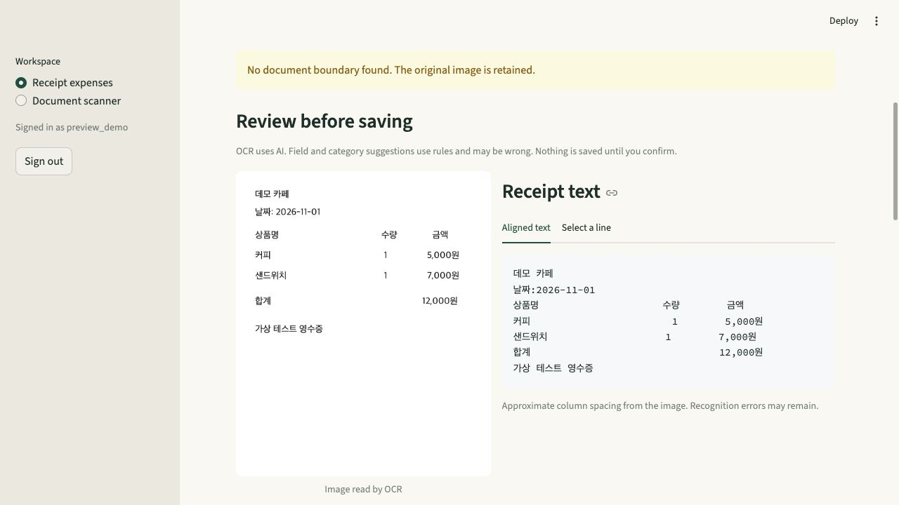

# ReceiptLens

**Multilingual AI Receipt & Expense Assistant** built with Python, OpenCV,
PaddleOCR and Streamlit, with optional Google Gemini translation.

Upload a receipt, read its printed text, review suggested fields and save it to a
personal expense ledger. Filter expenses, compare totals per currency and export CSV.
The separate document-scanner workspace exports PNG, image-only PDF and edited TXT.



## Features

- Local CPU OCR for **English, Uzbek Latin and Korean** using pretrained PP-OCRv5 models.
- JPEG/PNG/HEIC/HEIF input, limited to 10 MiB and 20 megapixels, with EXIF orientation.
- Automatic perspective correction, original-image fallback and rectangular manual crop.
- Approximate row/column layout and image highlighting for a selected text line.
- Optional Gemini translation, with explicit consent, line IDs and numeric-token checks.
- Account-scoped SQLite records, review before save, duplicate checks and confirmed deletion.
- Date/category filters, separate USD/UZS/KRW totals, monthly summaries and safe UTF-8 CSV.

OCR is pretrained AI; merchant/date/total/category suggestions use conservative rules.
Uncertain fields stay blank. Gemini translation never changes source OCR or expense values.
No OCR models were trained or fine-tuned for this project.

## Run locally

Use **Python 3.12**. The recorded macOS ARM64 environment and Linux amd64 container
have been tested. Commands run from the project root.

```sh
python3.12 -m venv .venv
source .venv/bin/activate
python -m pip install -r requirements-lock.txt
python -m streamlit run app.py
```

Open [ReceiptLens locally](http://127.0.0.1:8501/). It binds to loopback by default.
The first OCR use may download model weights; later runs reuse Paddle's local cache.
No Gemini key is needed for OCR or the expense ledger.

For development tools and checks:

```sh
python -m pip install -r requirements-dev.txt
python -m ruff check .
python -m ruff format --check .
python -m pytest -q
python -m pip check
```

`requirements.txt` pins runtime dependencies, `requirements-dev.txt` adds test/formatting
tools, and `requirements-lock.txt` records the macOS environment. The Docker build uses
`deploy/requirements-linux.txt`. Update platform dependency records deliberately.

## Read a receipt, then translate it

1. Sign in or create a local account in **Receipt expenses**.
2. Upload a receipt or choose **Try a demo receipt**.
3. Set **Language printed on receipt** to the receipt's original language.
   For a Korean receipt, choose **Korean**, even if you want an English translation.
4. Select automatic/original framing or adjust **Manual crop**, then click **Read receipt**.
5. Inspect **Receipt text** and the highlighted lines. This is source OCR, not translation.
6. To translate, open **Translate receipt text**, review what will be sent, select
   **Translate to**, consent and click **Translate text**. Download translation TXT if needed.
7. Check merchant, date, total and currency against the image; correct them and confirm
   before **Save expense**. **My expenses** provides filters, CSV export and deletion.

Exact duplicate images are blocked per account. Similar purchases need an additional
confirmation. USD/UZS use two decimal places; KRW uses whole won. Currencies are not
converted or added together. Dates are reviewed ISO dates, not inferred account timestamps.

### Optional Gemini configuration

Copy `.streamlit/secrets.example.toml` to `.streamlit/secrets.toml` and enter the key
**locally**, never in chat, Git, a screenshot or a command argument:

```toml
[gemini]
api_key = "YOUR_LOCAL_API_KEY"
```

Alternatively set the server environment variable `GEMINI_API_KEY`, which takes precedence.
The default model is `gemini-3.5-flash-lite`; `GEMINI_TRANSLATION_MODEL` selects another
compatible model. The old Cloud Translation settings are no longer used.
Restart Streamlit after changing configuration; saved expenses remain in the database.

Only the reviewed text is sent after Translate is clicked; the receipt image is not sent.
Numbers are protected locally and checked on return. Free-tier submitted content may be
used to improve Google products, so start with synthetic examples. Gemini quota/billing
is separate from hosting. No automatic retries or model fallback are performed.
A missing key disables translation. Model/configuration, quota and network failures show
safe messages. A valid response still needs human review for translation meaning.

[Gemini keys](https://ai.google.dev/gemini-api/docs/api-key) ·
[Model documentation](https://ai.google.dev/gemini-api/docs/models/gemini-3.5-flash-lite) ·
[Data terms](https://ai.google.dev/gemini-api/terms)

## Document scanner and CLI

Choose **Document scanner** for a single printed page. Select its source language,
scan it, review/edit text and click **Prepare downloads**. TXT includes edits;
PNG/PDF retain the pixels. The PDF has no searchable text layer.

```sh
python -m scanner samples/en.png --lang en --output outputs/demo/result.json
python -m scanner samples/uz.png --lang uz --original
python -m scanner.scan benchmarks/dataset/en/02-perspective.png --output-dir outputs/scan
```

CLI commands print recognized text and write only explicitly requested files. Use demo
inputs. The Python package remains `scanner`; the application/project name is ReceiptLens.

## Architecture

```text
app.py → ui.py → expense_ui.py / document scanner
                    ↓
        imaging.py → pipeline.py → ocr.py → layout.py
                    ↓
        reviewed fields → expense_store.py → expense_reports.py
                    ↓
        optional translation_ui.py → translation.py → Gemini
```

`settings.py` centralizes identity and database paths. `model_cache.py` owns per-session
predictors. Geometry, OCR, receipt rules, storage, reports, exports and translation remain
separate from presentation. See [AGENTS.md](AGENTS.md) for engineering standards and invariants.

## Verification and measured results

### Current cleanup verification

On **2026-11-05**, the installed ReceiptLens cleanup passed **159 tests in 11.75 seconds**,
Ruff lint/format checks, dependency consistency and local documentation links. The Linux amd64
image rebuilt successfully and its UI/backup/settings modules imported without network.
The new name was checked in an isolated browser preview. No new OCR benchmark or paid
Gemini call was needed for this refactor. [Current home screen](docs/images/receipt-lens-home.png).

### Recorded integration checks

On **2026-11-04**, the pre-cleanup suite passed 159 tests. The Linux amd64 image passed
HTTP health, real OCR on three synthetic receipts and SQLite backup/restore checks.
All 12 merchant/date/amount/currency fields matched those three clean references.
Its process peak RSS was about 1.24 GiB under a 3 GiB container limit; emulated timings
are not native cloud performance or a multi-user capacity estimate.

Real Gemini synthetic checks passed Korean → English, English → Uzbek and Uzbek → Korean,
with response structure, line mapping and preserved numbers validated. Translation meaning
has not been independently graded. These checks used no private receipts or operational DB.

### Synthetic document benchmark

The **2026-11-01** run used 15 distinct synthetic documents, five per language, and 30 paired
original/auto-scan measurements. CER is character edits divided by reference length after
NFC normalization and whitespace collapse; case, punctuation and apostrophe variants remain
significant. Model loading/warm-up are excluded; one timed pass per document/mode was recorded.

| Language | Original CER | Auto-scan CER | Mean auto-scan OCR |
|---|---:|---:|---:|
| English | 0.00% | 0.00% | 1.884 s |
| Uzbek Latin | 1.03% | 0.77% | 1.984 s |
| Korean | 6.09% | 5.42% | 1.744 s |

This is a small development set with limited fonts, not general real-photo accuracy.
The results predate later layout changes; cleanup does not imply a new benchmark run.
[Raw paired results](benchmarks/results/run-20261101T053508474554Z/results.json) and
[metadata](benchmarks/results/run-20261101T053508474554Z/metadata.json) preserve the evidence.

Optional real-model checks may download weights and write synthetic reports under ignored
`outputs/`. Ordinary pytest tests require no models or provider calls.

```sh
python -m scripts.verify_pipeline
python -m scripts.verify_receipts
python -m scripts.evaluate_benchmark
# Sends three synthetic requests; consumes Gemini quota:
python -m scripts.verify_translation --send-demo
```

## Google Cloud deployment

**Prepared and locally checked; not yet publicly deployed.** The proposed demo host is
one Linux amd64 VM, initially 2 vCPU / 4 GB RAM, with persistent storage. Confirm region,
current VM/disk/IP costs, trial eligibility, domain and quotas before provisioning.
The trial starts when activated; budget alerts are not a guaranteed spending cap.

Install Docker Engine/Compose on the new server using the [official Ubuntu instructions](https://docs.docker.com/engine/install/ubuntu/).
Clone the repository into `/opt/receipt-lens`. Keep local secrets, data, `.venv` and outputs
out of uploads. Copy `.env.deploy.example` to `.env.deploy`, restrict it with
`chmod 600 .env.deploy`, and enter the actual domain and key on the server.
Point that domain's DNS A record at the VM. Allow HTTPS/HTTP and restrict SSH;
port 8501 stays loopback-only.

```sh
docker compose --env-file .env.deploy config --quiet
docker compose --env-file .env.deploy build scanner
docker compose --env-file .env.deploy up -d
```

Caddy handles HTTPS. The app runs as UID 10001, with persistent `receipts` and `models`
volumes, CPU/memory limits and bounded logs. The Compose project name is `receipt-lens`.
Changing it after deployment changes default volume names: migrate existing data explicitly.
Health checks verify HTTP availability, not OCR quality or model download completion.

Before sharing publicly, verify external HTTPS, native OCR/memory use, account isolation,
operator quota/abuse controls, persisted demo data after restart and off-server backup restore.
Compose enables public mode. New accounts require at least 5 password characters.
Caddy supplies the direct client IP and keeps the app port on loopback. App-level rolling
budgets are per client and per process. The defaults are 5/60 signup attempts per day,
20/120 login attempts and accepted uploads per five minutes, 10/60 OCR requests per five
minutes, and 10/100 translation attempts per day. Counters reset on restart. Set a separate
Gemini provider quota. Caddy limits upload size, while the app limits which uploaded files
proceed to processing. Public OCR releases model instances after each run.

Start with a fresh server database;
local personal records are not automatically uploaded.

```sh
docker compose --env-file .env.deploy exec -T scanner python -m scanner.backup --output /app/data/backups/demo.sqlite3
```

Choose a new backup filename each time. The backup API makes a consistent private SQLite
copy and refuses overwrites. Transfer backups to protected off-server storage and test
restore using an isolated DB. Do not use `docker compose down -v` for updates: it removes
volumes. Plan continuation/migration before trial expiry; stopping a VM does not necessarily
stop disk or reserved-IP charges. Existing VPS projects are outside this deployment's scope.

[Cloud trial](https://cloud.google.com/free/docs/free-cloud-features) ·
[Pricing calculator](https://cloud.google.com/products/calculator) ·
[Budget alerts](https://cloud.google.com/billing/docs/how-to/budgets)

## Shared Coolify server (alternative)

**Prepared; not yet deployed.** On a server whose ports 80/443 belong to Coolify's Traefik,
deploy only the `Dockerfile` (no Compose, no Caddy). Settings: container port `8501`,
HTTPS domain, health check `GET http://127.0.0.1:8501/_stcore/health` (the image includes
`curl` for this), manual auto-deploy, Docker volumes `/app/data` and `/home/scanner`, and a
memory limit agreed with the server owner (OCR needs about 3 GB). Runtime-only variables:
`RECEIPTLENS_PUBLIC=1`, `RECEIPTLENS_CLIENT_IP_HEADER=X-Real-Ip`, `GEMINI_TRANSLATION_MODEL`
and, optionally, a dedicated `GEMINI_API_KEY`; Coolify team members may be able to read them.

Per-client limits trust that header only if the proxy overwrites a client-supplied value.
Verify this on the actual Traefik before public use. Coolify has no 12 MB proxy body limit
here; Streamlit's 10 MB upload limit and the app's image checks still apply.
`.github/workflows/ci.yml` runs ruff, pytest and a Docker build, and deploys through the
Coolify API only on `main` after both pass and the `COOLIFY_URL` variable is set.

## Data handling and limits

- One printed page and one explicitly selected OCR language; mixed-language accuracy,
  handwriting, table reconstruction, automatic language detection and searchable PDF are not guaranteed.
- Border detection and row spacing are geometric heuristics. Cropping is rectangular;
  manual four-corner correction is not implemented. Curled, blurry or glossy receipts remain difficult.
- Scanner-only data stays in session memory. Explicit expense Save stores a normalized
  metadata-free JPEG, source OCR, reviewed fields and source fingerprint in SQLite.
- Default DB: ignored `data/expenses.sqlite3`; override with `SCANNER_DB_PATH`. Scrypt
  password hashes and restrictive file permissions are used, without at-rest encryption.
- Sign-out clears session/drafts/model references, not saved expenses. Delete records from
  My expenses. Sessions expire after eight hours; no email/password-recovery flow exists.
- Single-process storage/throttling/inference controls are intended for a small demo.
  Public multi-user rollout needs durable protected storage, coordinated controls and security review.
- Desktop and synthetic inputs have been inspected; mobile layout and broad real-receipt accuracy
  are not established. Confidence scores are model scores, not accuracy percentages.

## Portfolio demo

Use synthetic receipts: show Korean source OCR and aligned columns, translate to English
or Uzbek, review/save a demo expense, filter the ledger and export CSV. Then show perspective
correction and PNG/PDF/TXT in the document workspace. Explain your Python integration and
measured limits; attribute the pretrained model. Screenshots are in `docs/images/`, including
[highlighted lines](docs/images/receipt-line-highlight.png) and the [demo ledger](docs/images/expense-ledger.png).
Older captures may show the previous product name. No finished demo video is bundled.

See [third-party notices](THIRD_PARTY_NOTICES.md). No project-wide source-code license has
been selected yet; upstream software and model licenses remain applicable.
